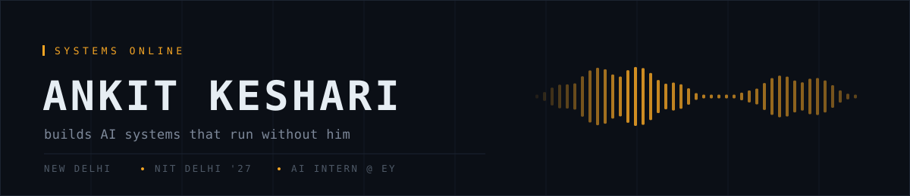

<p align="center">
  
</p>

I'm a mechanical engineering student at NIT Delhi who fell down the AI rabbit hole and never climbed back out. Most of what I build is an assistant of some kind — things that keep working after I close the laptop.

Two rules, and they're the whole method: **it has to ship, and the numbers have to be real.**

### ▸ Systems

```text
SUNDAY        job-hunt agent        ● live      daily 10:00 IST · never applies twice
WHISPERFLOW   offline dictation     ● local     ~1.5s end-to-end · CPU only · 0 cloud calls
NEWS MONITOR  NSE news sentiment    ● running   grades itself against next-day close
CHIEF         telegram ops bot      ◐ building  cloudflare workers · zero authority
SWING BOT     nse swing trader      ○ private   ₹1,000 hard cap · backtest→paper→live
```

**[SUNDAY](https://github.com/maverick14303/sunday_find_me_a_job)** — Not Tony Stark, but I've got my own assistant. Every morning she scrapes AI/ML openings, ranks them against my real resume, builds ATS-safe PDFs, and emails me the top five. I reply with a company name and she applies. She never emails the same company twice.

**[WhisperFlow Local](https://github.com/maverick14303/whisperflow-local)** — Hold a hotkey, speak, and the words land at your cursor in whatever app is focused. Silero VAD gates the mic, faster-whisper transcribes on CPU, a local Ollama model cleans it up. Nothing leaves the machine.

**[Stock News Monitor](https://github.com/maverick14303/stock-news-monitor)** — The goal was never prediction. It was measurement: does news sentiment carry any next-day signal at all? So it scores every (headline, company) pair, then checks itself against what the stock actually did.

### ▸ Currently

**AI Intern at EY** — building an LLM document-intelligence platform for a government client. Scanned journals in, defensible scores out, every score quoting the exact line it came from.

**Before that, DRDO** — Scientific Analysis Group, adversarial ML. I attacked face-recognition models to measure how they break: black-box SimBA and NES pipelines across 8+ models and 9,000+ samples, plus transfer-based PGD.

### ▸ Stack

```text
ml       PyTorch · TensorFlow · scikit-learn · DeepFace · NumPy · Pandas
local    Ollama · faster-whisper · Silero VAD · CTranslate2
ship     Next.js · TypeScript · FastAPI · Supabase · Cloudflare Workers · Vercel
core     Python · Java · adversarial ML · DSA (daily, in Java)
```

### ▸ Contact

Reach me on **[LinkedIn](https://www.linkedin.com/in/ankit-keshari-105846255/)** — that's the one I actually check.

[Portfolio](https://ankit-portfolio-4j2.pages.dev) · [ankitkeshari326@gmail.com](mailto:ankitkeshari326@gmail.com) · New Delhi, India

Open to AI/ML internships and freelance builds.
